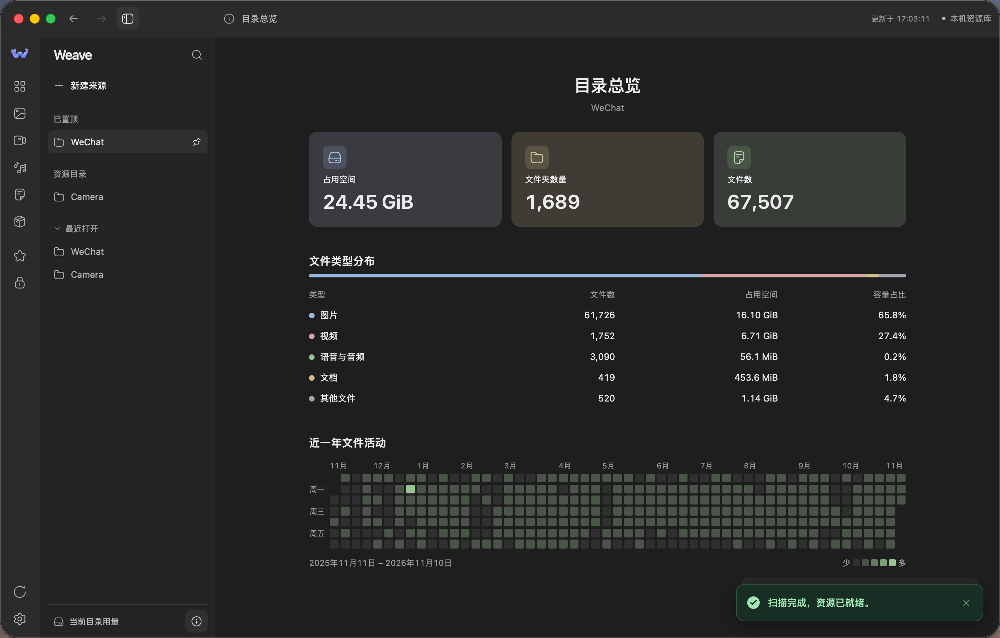
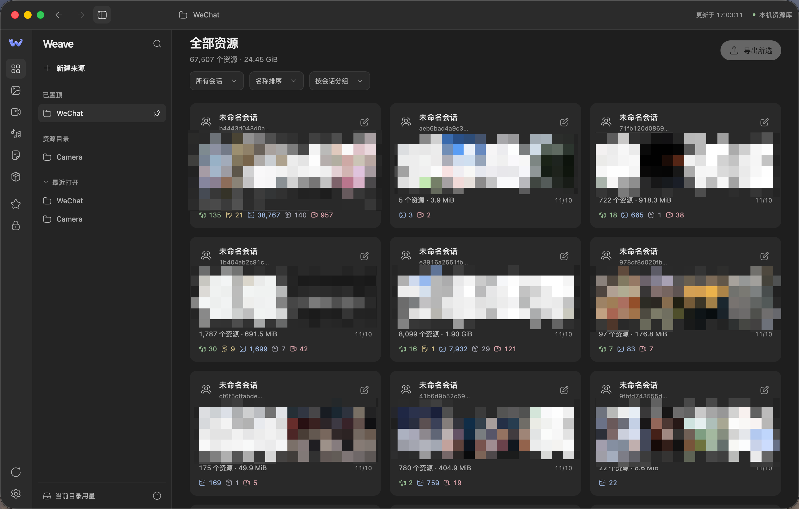

# Weave

[简体中文](README.zh-CN.md)

Weave is a local file browser for macOS. It recognizes ordinary folders and WeChat conversation directories, so you can find, preview, organize, and export images, videos, voice messages, and documents while keeping the originals in place.

<p>
  
  
</p>

## Features

| Feature | What you can do |
| --- | --- |
| Directory overview | See storage use, file and folder counts, file type breakdown, and a year of file activity. |
| Browse your library | Browse ordinary folders by their real hierarchy, including empty folders, with breadcrumb navigation. Browse WeChat resources by conversation. Both sources support a flat file view, grid and list layouts, and sorting by modification time, size, or name. Conversations group files by date. |
| Detect folder type | Detection is automatic by default. See the detected type and active mode in **Settings → Data & storage**. Override with Ordinary folder or WeChat conversations, or restore Automatic. Mode and grouping choices are saved separately for each resource root. |
| Scan ignore | In **Settings → Scan ignore**, edit and reorder scan ignore patterns. Projects can inherit the global rules, add higher-priority rules, or use only their own. Edits save when you leave the field and apply on the next scan. |
| Search and organize | Search filenames, tags, and bound conversation names or account identifiers. Combine file-type, conversation, and favorites filters; select multiple file types within a conversation. Add favorites and tags for later. |
| Preview and play | View images, paired originals and thumbnails, file details, formatted Markdown, TXT and CSV, continuous PDF previews, and built-in Word, Excel, and PowerPoint viewers. Open previews fullscreen and press Esc to return. View syntax-highlighted source code and format supported files with Oxfmt. Play video and audio with seeking, volume, and speed controls; navigate audio with a waveform. Decode SILK and AMR-NB voice messages locally. |
| Name conversations | Manually associate folder identifiers with confirmed contact names, group chats, or custom names. Import mappings in JSON; bindings are kept separately for each resource root. |
| Export files | Reveal a file in Finder or copy up to 200 selected resources to a folder using the native directory picker. Exported files use `resourceID_originalFilename` and do not overwrite existing files. |

The interface supports English and Simplified Chinese, dark / light / system appearance, three color palettes, and comfortable or compact spacing. Preferences are saved automatically. Virtual scrolling, thumbnail caching, and background audio decoding help keep large libraries responsive.

## Quick start

1. Click **New Source** in the sidebar and choose a local folder. Weave scans it and detects whether it contains ordinary folders or WeChat conversation resources.
2. Press `⌘K` or click the magnifying glass in the sidebar to open the command palette. Pin frequently used folders in the sidebar.
3. Click the info button next to the current directory usage at the bottom of the sidebar to open the directory overview.
4. Select the files you want to copy, click **Export selected**, and choose a destination folder.

### Installation and first launch

Requires macOS 12 or later. Choose a package matching your Mac: `arm64` for Apple silicon or `amd64` for Intel. Availability depends on the files attached to the release.

1. Download and open the `.dmg` from [GitHub Releases](https://github.com/zyyv/weave/releases).
2. Drag **Weave.app** into **Applications**, then launch Weave from Applications. Eject the disk image after installation. Alternatively, download the ZIP, extract it, and move Weave.app into Applications.

> [!NOTE]
> The current build uses an ad-hoc signature and ships without Apple notarization. If macOS blocks Weave after you first try opening it from **Applications**, confirm you downloaded it from the official release, then go to **System Settings → Privacy & Security → Open Anyway**. Authenticate if prompted and confirm that you want to open Weave. On macOS 12, look under **System Preferences → Security & Privacy → General**.
>
> If macOS reports that Weave is damaged or contains malware, stop installation and check the download. [Apple’s instructions](https://support.apple.com/en-us/102445)

## Local data and limitations

Browsing, favoriting, and tagging leave source files unchanged. In the desktop app, confirming deletion in file details moves the file to the system Trash, where it can be restored. Previews, playback, and voice decoding run locally without external requests. The local service listens only on `127.0.0.1`, using random ports and an app access path. The Office renderer runs on an isolated local origin.

Library metadata is stored separately in `~/Library/Application Support/Weave/`:

| File | Contents |
| --- | --- |
| `marks.json` | Favorites and tags |
| `source.txt` | Selected resource directory |
| `settings.json` | Preferences, source modes and browsing choices, scan ignore rules, and conversation bindings |

- **Conversation names are manual.** Weave does not decrypt contact or session databases, infer names from folder hashes, or verify account ownership.
- **Preview support depends on the format.** Encrypted DAT / PIC images and unsupported media codecs cannot be previewed. SILK / AMR-NB decoding is limited to 16 MiB per file and 15 minutes of decoded audio; AMR-WB is unsupported. Original files can still be exported.
- **Document previews.** Scroll through PDF pages continuously. Built-in Office renderers open DOC/DOCX, XLS/XLSX, and PPT/PPTX locally without a separate Office installation. Office previews are read-only, accept files up to 100 MiB, and can differ from the original layout.
- **Text and code previews.** TXT, Markdown, CSV, and source files show up to the first 128 KiB. Markdown displays link and image labels as text. HTML opens as source code. The bundled Oxfmt formatter handles complete JS, TS, HTML, CSS, JSON, YAML, TOML, GraphQL, Vue, and MDX files among other supported variants. Formatting only changes the preview.
- **Dates and availability come from local files.** Modification times may differ from message timestamps. Files removed from the source directory are no longer available for preview or export; rescan to refresh the library.

## Build locally

On macOS, install Go (see `go.mod`) and Node.js 22.12 or later, then run:

```sh
npm ci
./build.sh
```

The script reads the version from `package.json` and produces `build/Weave.app`, `build/Weave-v<version>-macOS-<arch>.dmg`, and `.zip`, using the local Go target architecture by default (typically `arm64` on Apple silicon). It verifies the app signature and DMG checksum. Use these generated packages; copying `.app` bundles directly through synced Documents folders can affect signing metadata.

### Development preview

After `npm ci`, run `npm run dev` for the desktop app with development tools, or `npm run dev:browser` for a browser preview that reads frontend changes on refresh.

The `--dev` flag enables development tools. In Settings → Data & storage, click Replay tour (dev) to preview from the first step without clearing the source folder or completion status. Click Finish preview at the last step. Development tools are off by default for normal launches and packaged apps.

## Credits

Weave uses the following open-source projects.

| Dependency | Role |
| --- | --- |
| [Hugeicons](https://github.com/hugeicons/hugeicons) · `@iconify-json/hugeicons` 1.2.35 | Interface and player icons, bundled locally as SVG. [MIT](frontend/vendor/hugeicons/LICENSE.txt). |
| [MyGo](https://github.com/egoist/mygo) · 0.7.4 | macOS desktop shell and system WKWebView integration. |
| [WaveSurfer.js](https://github.com/katspaugh/wavesurfer.js) · 8.0.5 | Audio playback and waveform navigation. [BSD-3-Clause](frontend/vendor/wavesurfer/LICENSE). |
| [Video.js](https://github.com/videojs/video.js) · 10.3.0 | Video playback with the Neutral skin, bundled from `@videojs/cdn`. [Apache-2.0](frontend/vendor/videojs/APACHE-LICENSE-2.0.txt); [upstream notices](frontend/vendor/videojs/LICENSE). |
| [silk-wasm](https://github.com/idranme/silk-wasm) · 3.7.1 | Local decoding of SILK voice messages. [MIT](frontend/vendor/SILK-LICENSE.txt). |
| [benz-amr-recorder](https://github.com/BenzLeung/benz-amr-recorder) · 1.1.5 | Local AMR-NB decoding using its worker source. [MIT and decoder notices](frontend/vendor/AMR-LICENSE.txt). |
| [x18n](https://github.com/x18n-dev/x18n) | English and Simplified Chinese translation management during development. |
| [File Viewer](https://github.com/flyfish-dev/file-viewer) | Built-in Office previews. [Licenses](frontend/office-frame/vendor/licenses/). |
| [PDF.js](https://github.com/mozilla/pdf.js) | PDF rendering. [Apache-2.0](frontend/vendor/pdfjs/LICENSE). |
| [Marked](https://github.com/markedjs/marked) | Markdown parsing. [MIT](frontend/vendor/marked/LICENSE.md). |
| [Prism](https://github.com/PrismJS/prism) | Syntax highlighting. [MIT](frontend/vendor/prism/LICENSE). |
| [Oxfmt](https://github.com/oxc-project/oxc) | Source formatting for previews. |
| [exifr](https://github.com/MikeKovarik/exifr) | Image metadata parsing. [MIT](frontend/vendor/exifr/LICENSE). |

Media dependencies are bundled locally. The SILK module and WebAssembly files are unmodified; the AMR decoder's CommonJS factory is wrapped for use as a standalone worker, without microphone or recording APIs. Decoder license notices are retained. Video.js production JavaScript and CSS and the WaveSurfer ESM bundle are retained with their licenses; package sources and integrity hashes are recorded in the respective `VENDORED.json` files. Playback and decoding use local assets, with no analytics or remote media services enabled.

## License

Weave is licensed under the [Apache License 2.0](LICENSE). See Credits above for third-party licenses and notices.

Copyright (c) 2026 Chris (zyyv)
